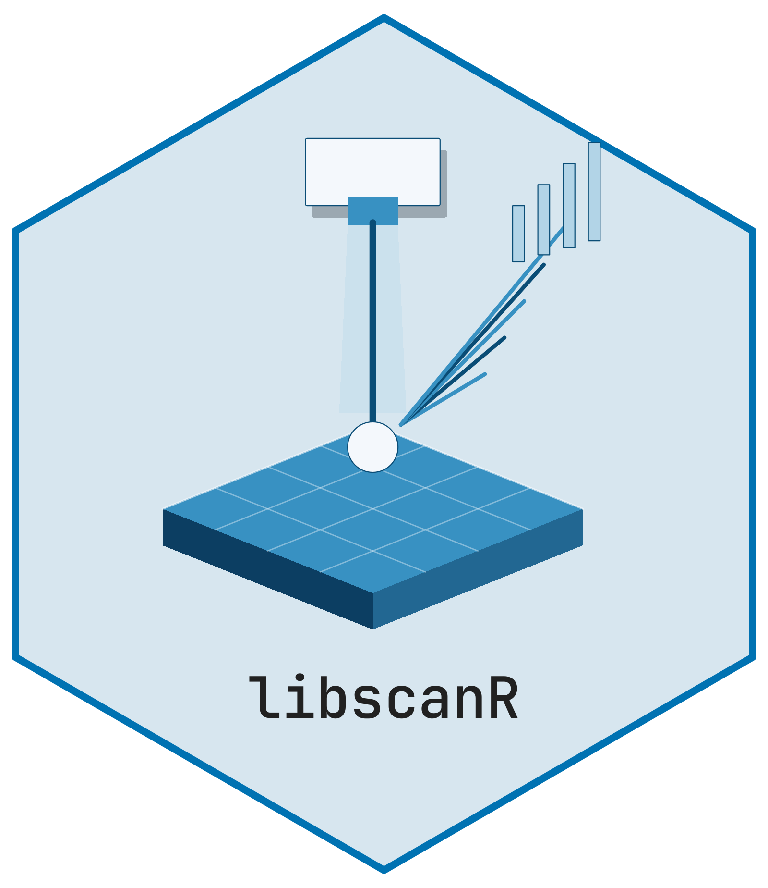

# libscanR 

Vendor-agnostic analysis and visualization of **Laser-Induced Breakdown
Spectroscopy (LIBS)** data in R, with a focus on biomedical tissue
research. This is experimental research software. Synthetic examples and
heuristic tissue labels do not establish clinical performance.

## Features

- **Import**: Generic CSV/TSV/TXT, SciAps Z-series, Applied Spectra
  J200/Aurora, auto-detection.
- **Preprocessing**: SNIP/ALS baseline correction, five normalization
  modes, Savitzky-Golay / Gaussian / moving-average / median smoothing,
  shot averaging with outlier removal, wavelength cropping, gate delay
  optimization.
- **Peak analysis**: SNR+prominence peak detection; identification
  against a user-supplied local atomic reference. No NIST compilation is
  bundled. Missing transition rates and ambiguous candidates remain
  explicit; wavelength scores are not probabilities.
- **Calibration**: Univariate, internal-standard and PLS prediction with
  retained wavelength and processing contracts. The two-stage
  Saha-Boltzmann calculation requires explicit atomic data, partition
  functions, density and instrument response; it estimates relative
  elemental number fractions under stated assumptions.
- **Chemometrics**: PCA, PLS-DA, k-means / hierarchical clustering, SVM
  / Random-Forest classifiers.
- **Tissue analysis**: Exploratory rule-based tissue labels using
  elemental ratios; discriminating-line analysis with FDR correction.
- **Spatial mapping**: Single-element and multi-element 2-D maps from
  raster-scan datasets.
- **Visualization**: Publication-ready ggplot2 plots; custom
  [`theme_libs()`](https://cttir.github.io/libscanR/reference/theme_libs.md)
  and wavelength color scale.
- **Shiny app**: Six-tab interactive explorer
  ([`ls_run_app()`](https://cttir.github.io/libscanR/reference/ls_run_app.md)).
- **Reproducible examples**:
  [`ls_example_data()`](https://cttir.github.io/libscanR/reference/ls_example_data.md)
  provides synthetic tissue, calibration, and spatial datasets — no
  instrument data required.

## Installation

Use R 4.1 or newer. Install the source from GitHub, or use
`install_local(".")` from a checkout. Atomic-reference data are optional
and downloaded separately; the teaching examples below do not need them.

``` r

install.packages("remotes", repos = "https://cloud.r-project.org")
remotes::install_github("CTTIR/libscanR", upgrade = "never")

# Explorer and the optional PLS, SVM, forest and density-clustering methods:
install.packages(c("bslib", "plotly", "DT", "shinyWidgets", "pls", "e1071", "ranger", "dbscan"),
                 repos = "https://cloud.r-project.org")
```

The core requires R and the dependencies in `DESCRIPTION`. Compiling
dependencies from source may require the usual R build tools for your
platform. Vignettes are available on the [documentation
site](https://cttir.github.io/libscanR/articles/); for local copies
install `knitr` and `rmarkdown`, then use
`remotes::install_local(".", build_vignettes = TRUE, upgrade = "never")`.
The complete-spectrum ZIP download also needs a ZIP utility on `PATH` or
configured with `R_ZIPCMD`, including on Windows. The other CSV exports
do not require it.

A CRAN release and the previously recorded Zenodo identifier were not
confirmed during the maintenance audit on 3 November 2026. No new CRAN
or archival release is claimed here.

## Quick start

``` r

library(libscanR)

# Generate an explicitly fictional teaching spectrum
spec <- ls_simulate_spectrum(
  line_data = ls_demo_peaks(),
  elements = c(Ca = 5000, Na = 1000, Fe = 200),
  seed = 1
)

# Preprocess: baseline, smooth, normalize
spec_proc <- spec |>
  ls_baseline(method = "snip") |>
  ls_smooth(method = "moving_avg", window = 5) |>
  ls_normalize(method = "total")

# Detect and plot peaks without an atomic reference
peaks <- ls_find_peaks(spec_proc)
ls_plot_spectrum(spec_proc, show_peaks = TRUE)

# Export all shots and metadata for a later import
folder <- tempfile("libs-example-")
ls_export_spectra(ls_dataset(list(spec)), folder)
restored <- ls_read_dir(folder)

# Launch the interactive app (requires the optional explorer packages above)
ls_run_app(data = ls_example_data("tissue"))
```

## Optional atomic-reference setup

Basic import, preprocessing, calibration with an explicit numerical
line, chemometrics, mapping, the synthetic Saha example and teaching
datasets work without an atomic reference. Atomic identification,
element overlays and the default
[`ls_simulate_spectrum()`](https://cttir.github.io/libscanR/reference/ls_simulate_spectrum.md)
require one. There is no automatic download or fallback to fictional
atomic values.

1.  Open the [NIST ASD Lines
    Form](https://physics.nist.gov/PhysRefData/ASD/lines_form.html) and
    review the provider’s terms. Enter the spectra needed for your
    experiment, for example **Ca I; Ca II**. Select **nm**, your
    wavelength range, **CSV** output, **eV** energies, **Aki in s^-1**,
    **Vacuum (all wavelengths)**, observed and Ritz wavelengths, **g**
    values and bibliographic references. Use **All** lines. Request at
    least two spectra so the CSV contains `element` and `sp_num`. Save
    the downloaded CSV and its actual query URL locally. Do not
    open/save it through a spreadsheet application before conversion.

2.  Use Python 3.9 or newer (standard library only). The example date
    and query URL below must be replaced with your actual download date
    and URL. `local-data/` is ignored by Git and source-package builds:

    ``` sh
    mkdir -p local-data
    # Save your download as local-data/nist-download.csv first.
    importer="$(Rscript -e 'cat(system.file("scripts", "import_nist.py", package = "libscanR"))')"
    python3 "$importer" local-data/nist-download.csv local-data/atomic-lines.csv \
      --retrieved-date YYYY-MM-DD --source-url 'PASTE_THE_ACTUAL_NIST_QUERY_URL'
    ```

    The importer preserves all supplied rows, prefers Ritz wavelengths,
    retains source references and missing values, flags estimated upper
    energies, and writes a `.provenance.json` file with input/output
    SHA-256 hashes. It refuses unsupported units, ambiguous numeric
    fields, mixed wavelength media and existing output files. It does
    not download data or infer persistent-line designations. An air-only
    file keeps its medium and has no invented vacuum counterpart. Keep
    the original download with its receipt.

3.  Configure the resulting file in R. An explicit `path` overrides the
    option, which overrides `LIBSCANR_ELEMENT_DB`:

    ``` r

    options(libscanR.element_db = normalizePath("local-data/atomic-lines.csv"))
    reference <- ls_element_db(elements = "Ca")
    # Or use Sys.setenv(LIBSCANR_ELEMENT_DB = "/absolute/path/atomic-lines.csv")
    # Or inspect one file without changing the session:
    ls_element_db(path = "local-data/atomic-lines.csv", range_nm = NULL)
    id <- ls_identify_peaks(peaks, elements = "Ca")
    ```

The reader also accepts an RDS data frame with the documented schema; it
retains extra provenance fields. The helper does not certify reference
accuracy, licensing, LTE assumptions or instrument response. Do not mix
air and vacuum measurement axes. Statistical tissue discrimination
remains available without a reference, with
`annotation_status = "reference_unavailable"`; invalid configured files
raise an error. See the [NIST output
documentation](https://physics.nist.gov/PhysRefData/ASD/Html/lineshelp.html)
for units and atomic-data qualifications.

## Scientific inputs and migration

The old bundled atomic table is removed. User reference files must
explicitly state source and air/vacuum convention; missing rates are not
invented. Configure them using the steps above. Existing simulations
that relied on the old table must either configure a real reference or
explicitly select the fictional teaching input.
[`ls_example_data()`](https://cttir.github.io/libscanR/reference/ls_example_data.md)
always uses fictional peaks with invented strengths; its
tissue/component labels are teaching labels, not biological ground
truth. Simulated spectra retain the source type and teaching peak table
in metadata.

Old calibration and classifier objects that lack an explicit feature
contract must be refitted. Tissue output now uses `score`, `score_type`
and `status` in place of the ambiguous `confidence` column; PLS-DA
predictions use `score` instead of a probability label. Keep the
training wavelength axis and processing sequence for new samples,
including any internal-standard line. Align mismatched axes
deliberately; the reader and dataset constructor do not silently relabel
channels.

For a complete, fictional two-stage LTE calculation:

``` r

source(system.file("examples", "saha-boltzmann-synthetic.R", package = "libscanR"))
result <- do.call(ls_saha_boltzmann, saha_synthetic_example())
result  # X = 0.7, Y = 0.3; temperature = 10000 K
attr(result, "assumptions")
```

These fractions cover only the supplied elements. The method does not
verify LTE, optical thinness, spectral resolution or matrix-independent
ablation. Use measured instrument response and independently justified
physical inputs for research data. Old results from the incomplete
Saha-Boltzmann implementation must be recalculated.

## Workflow vignettes

- [`vignette("getting-started", package = "libscanR")`](https://cttir.github.io/libscanR/articles/getting-started.md)
- [`vignette("preprocessing-workflow", package = "libscanR")`](https://cttir.github.io/libscanR/articles/preprocessing-workflow.md)
- [`vignette("calibration-quantification", package = "libscanR")`](https://cttir.github.io/libscanR/articles/calibration-quantification.md)
- [`vignette("tissue-classification", package = "libscanR")`](https://cttir.github.io/libscanR/articles/tissue-classification.md)
- [`vignette("spatial-mapping", package = "libscanR")`](https://cttir.github.io/libscanR/articles/spatial-mapping.md)

## Citation

``` r

citation("libscanR")
```

## License

Software: MIT © Raban Heller. No NIST reference compilation, selected
source rows or legacy atomic table is distributed in this source tree or
package. References downloaded by users retain their providers’ terms;
the software license grants no rights in those files. See
`inst/NOTICE-NIST.md`.

## Use of LLM tools

Where applicable, LLM tools were used for narrowly defined,
non-authorial tasks: copyediting, prose refinement, Markdown/LaTeX
formatting, boilerplate scaffolding (such as CI configurations and build
scripts), and code refactoring. Tools included [Chat
AI](https://kisski.gwdg.de/leistungen/2-02-llm-service/), the KISSKI
(GWDG) service, and self-hosted **Mistral Small (24B, Apache-2.0)**
served through a local **vLLM architecture** on an Ubuntu Linux
workstation with Intel processors and NVIDIA GPUs. Self-hosted use also
includes models that were further trained (fine-tuned) or weight-edited
in-house for specific tasks. All self-hosted models ran locally, with no
data sent to third parties.

All scientific claims, methodological choices, analyses, interpretations
and conclusions remain the authors’ own. Where applicable, LLM-generated
material must be reviewed and revised before inclusion, and references
must be verified against their DOI, arXiv ID or ISBN.

Local software setup: vLLM with Python/PyTorch, plus R and RStudio.

## Branding

Editable R sources and regeneration instructions are in
[tools/branding](https://github.com/CTTIR/libscanR/tree/main/tools/branding).
