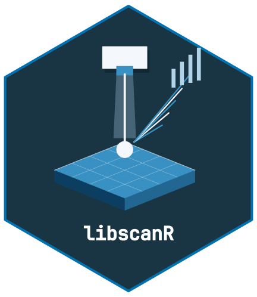

<!-- cttir-vignette-logo: start -->
<style>
.cttir-vignette-logo { float: right; width: 120px; max-width: 30%; margin: 0 0 1rem 1.5rem; }
.cttir-vignette-logo img { width: 100%; height: auto; border: 0; background: transparent; box-shadow: none; }
.cttir-vignette-logo .cttir-vignette-logo-light { display: block; }
.cttir-vignette-logo .cttir-vignette-logo-dark { display: none; }
@media (prefers-color-scheme: dark) {
  .cttir-vignette-logo .cttir-vignette-logo-light { display: none; }
  .cttir-vignette-logo .cttir-vignette-logo-dark { display: block; }
}
[data-bs-theme="light"] .cttir-vignette-logo .cttir-vignette-logo-light { display: block; }
[data-bs-theme="light"] .cttir-vignette-logo .cttir-vignette-logo-dark { display: none; }
[data-bs-theme="dark"] .cttir-vignette-logo .cttir-vignette-logo-light { display: none; }
[data-bs-theme="dark"] .cttir-vignette-logo .cttir-vignette-logo-dark { display: block; }
</style>
<div class="cttir-vignette-logo">
  
  
</div>
<!-- cttir-vignette-logo: end -->

```{r setup, include = FALSE}
knitr::opts_chunk$set(
  collapse = TRUE,
  comment = "#>",
  fig.width = 7,
  fig.height = 4.5,
  message = FALSE,
  warning = FALSE
)
```

```{r}
library(libscanR)
```

## From peak area to concentration

A LIBS calibration converts measured peak area (or intensity ratio) to
elemental concentration using a set of matrix-matched standards.

### Synthetic calibration dataset

```{r data}
cal_ds <- ls_example_data("calibration")
cal_ds
conc <- cal_ds$sample_info$concentration
unique(conc)
```

### Univariate calibration

```{r univariate}
cal <- ls_calibrate(cal_ds, element = "Ca", line_nm = 393.37,
                    concentrations = conc, method = "univariate",
                    verbose = FALSE)
cal
```

### Visualize

```{r plot, fig.alt="Concentration versus integrated response near 393.37 nm for 27 fictional teaching standards, with fitted line, 95 percent prediction band and estimated LOD and LOQ levels."}
ls_plot_calibration(cal)
```

### Residual diagnostics

```{r residuals, fig.alt="Residual concentration versus fitted concentration for the fictional Ca-labelled calibration, with a horizontal zero-residual reference line."}
ls_plot_residuals(cal)
```

### Internal standard calibration

An internal standard needs a measured, positive reference response in every
spectrum. The broad noisy display dataset above does not guarantee this. The
following separate numerical example uses two resolved Gaussian peaks, a constant
reference and a small deterministic background perturbation. It demonstrates the
ratio workflow, not a physically validated plasma or correction for matrix effects.

```{r internal}
wl_is <- c(seq(392, 395, by = 0.02), seq(587, 591, by = 0.02))
spectra_is <- lapply(seq_along(conc), function(i) {
  response <- 5 + 0.1 * conc[i] * exp(-0.5 * ((wl_is - 393.37) / 0.12)^2) +
    20 * exp(-0.5 * ((wl_is - 589.00) / 0.12)^2) +
    0.1 * sin(3 * wl_is + i)
  ls_spectrum(wl_is, response,
              metadata = list(sample_id = paste0("ratio_standard_", i)))
})
is_ds <- ls_dataset(spectra_is)
cal_is <- ls_calibrate(is_ds, "Ca", 393.37, concentrations = conc,
                       method = "internal_std",
                       internal_std_nm = 589.00,
                       verbose = FALSE)
cal_is
ls_quantify(cal_is, is_ds)
```

### PLS calibration

```{r pls, eval = requireNamespace("pls", quietly = TRUE)}
cal_pls <- ls_calibrate(cal_ds, "Ca", 393.37, concentrations = conc,
                        method = "pls", n_components = 5,
                        verbose = FALSE)
cal_pls
```

## Quantifying unknowns

The calibration retains its exact wavelength axis, ordered preprocessing,
integration window, and internal-standard line or PLS feature columns. Apply the
same processing to new measurements. `ls_quantify()` reuses the saved recipe and
rejects a different supplied window, changed channel labels or missing legacy
contracts. Refit models created before the contract was introduced.

```{r quantify}
ls_quantify(cal, cal_ds)
```

## LOD and LOQ

For univariate and internal-standard fits, the estimates are `3 * sigma / abs(slope)`
and `10 * sigma / abs(slope)`, where the slope and residual standard deviation are
from an auxiliary response-on-concentration regression. These estimates have the
calibration concentration unit and remain invariant under instrument gain. The
inverse concentration-on-response model still supplies predictions.

The package retains its stated three-sigma convention. The
[IUPAC definition](https://goldbook.iupac.org/terms/view/L03540) makes the factor
depend on the chosen certainty, while
[ICH Q2(R2), section 3.2.3.3](https://database.ich.org/sites/default/files/ICH_Q2%28R2%29_Guideline_2023_1130_ErrorCorrection_2025.pdf)
uses 3.3 for the response-standard-deviation method and requires suitable
verification near the proposed limits. These functions do not establish
compliance with a validation protocol.

A supplied blank needs at least two replicate shots with the fitted wavelength
and processing contract. Its noise is the variation of the integrated response
(or internal-standard ratio) across shots, not variation across channels. Confirm
performance independently near any proposed instrument limit. PLS returns `NA`
for LOD/LOQ and reports training RMSE separately; missing limits produce missing
below-limit flags rather than a claim that a result exceeds a known limit.

```{r lod}
ls_lod(cal)
ls_loq(cal)
```

## Relative elemental amounts under a two-stage LTE model

This calculation requires independently justified electron density, first ionization
energies, partition functions, resolved transitions and instrument-response factors.
The line wavelengths must use the same air or vacuum convention as the measured
axis. A good fit does not establish LTE, optical thinness or stoichiometric ablation.

The example below uses fictional X/Y transitions and intensities calculated by an
independent high-precision forward model. The ordinary spectrum simulator is a
Gaussian display model and does not simulate Boltzmann or Saha populations.

```{r cf}
source(system.file("examples", "saha-boltzmann-synthetic.R", package = "libscanR"))
inputs <- saha_synthetic_example()
result <- do.call(ls_saha_boltzmann, inputs)
result
attr(result, "line_diagnostics")
```

The expected temperature is 10000 K and the relative elemental number fractions
are X = 0.7 and Y = 0.3. Fractions are normalized over the supplied elements only;
they are not mass fractions or absolute concentrations. The model includes neutral
and singly ionized stages, excluding molecules and higher charge states. No real
instrument or tissue data were used to qualify this example.

For experimental work, supply verified atomic records and retain their references.
`ls_element_db()` reads user-supplied atomic reference fields, but missing rates or vacuum
wavelengths must be resolved from primary sources before those rows can be used.
Partition functions and response factors are not provided by the line database.

See the [NIST line and Saha/LTE documentation](https://physics.nist.gov/PhysRefData/ASD/Html/lineshelp.html)
for the conventions. The previous incomplete implementation omitted required
physics; its outputs cannot serve as quantitative references and must be recalculated.
