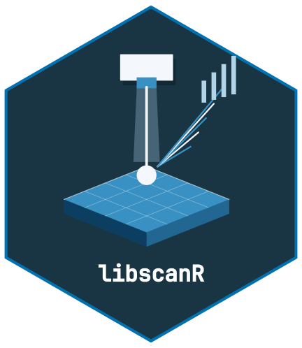

<!-- cttir-vignette-logo: start -->
<style>
.cttir-vignette-logo { float: right; width: 120px; max-width: 30%; margin: 0 0 1rem 1.5rem; }
.cttir-vignette-logo img { width: 100%; height: auto; border: 0; background: transparent; box-shadow: none; }
.cttir-vignette-logo .cttir-vignette-logo-light { display: block; }
.cttir-vignette-logo .cttir-vignette-logo-dark { display: none; }
@media (prefers-color-scheme: dark) {
  .cttir-vignette-logo .cttir-vignette-logo-light { display: none; }
  .cttir-vignette-logo .cttir-vignette-logo-dark { display: block; }
}
[data-bs-theme="light"] .cttir-vignette-logo .cttir-vignette-logo-light { display: block; }
[data-bs-theme="light"] .cttir-vignette-logo .cttir-vignette-logo-dark { display: none; }
[data-bs-theme="dark"] .cttir-vignette-logo .cttir-vignette-logo-light { display: none; }
[data-bs-theme="dark"] .cttir-vignette-logo .cttir-vignette-logo-dark { display: block; }
</style>
<div class="cttir-vignette-logo">
  
  
</div>
<!-- cttir-vignette-logo: end -->

```{r setup, include = FALSE}
knitr::opts_chunk$set(
  collapse = TRUE,
  comment = "#>",
  fig.width = 7,
  fig.height = 4.5,
  dpi = 96
)
```

```{r load}
library(libscanR)
```

## What is libscanR?

`libscanR` provides a vendor-agnostic pipeline for Laser-Induced Breakdown
Spectroscopy (LIBS) data, including import, preprocessing, peak detection,
calibration, quantification, chemometrics, spatial mapping, and
visualization. It includes explicitly fictional teaching datasets. Atomic-line identification
requires a separately downloaded, user-configured reference; no NIST compilation
is bundled. See the README for local download/import configuration.

## Core data structures

`libscanR` defines three S3 classes:

* `libs_spectrum` — a single spectrum (possibly multi-shot).
* `libs_dataset` — a collection of spectra sharing a wavelength axis.
* `libs_calibration` — a fitted calibration model.

## A 5-minute tour

### Simulate a spectrum

```{r simulate}
spec <- ls_simulate_spectrum(line_data = ls_demo_peaks(),
  elements = c(Ca = 5000, Na = 1000, Fe = 200),
  n_channels = 1024,
  seed = 1
)
spec
```

### Plot it

```{r plot-raw, fig.alt="Fictional teaching spectrum: mean intensity across wavelengths from 200 to 900 nm, including simulated peaks and a continuum background."}
ls_plot_spectrum(spec)
```

### Preprocess: baseline, smooth, normalize

```{r preprocess, fig.alt="The same fictional spectrum after SNIP baseline correction, five-channel moving-average smoothing and total normalization; the vertical scale is normalized intensity."}
spec_proc <- spec |>
  ls_baseline(method = "snip", iterations = 40) |>
  ls_smooth(method = "moving_avg", window = 5) |>
  ls_normalize(method = "total")
ls_plot_spectrum(spec_proc)
```

### Detect peaks without an atomic reference

```{r peaks}
peaks <- ls_find_peaks(spec_proc, snr_threshold = 3)
head(peaks)
```

Atomic identification is a separate, optional step. First configure a reference
using the README instructions. These candidates are wavelength matches, not
proof of an element's presence:

```{r identify, eval=FALSE}
options(libscanR.element_db = "local-data/atomic-lines.csv")
id <- ls_identify_peaks(peaks, elements = c("Ca", "Na", "Fe"))
ls_plot_spectrum(spec_proc, show_elements = c("Ca", "Na"))
```

### Read from a file

```{r read}
tmp <- tempfile(fileext = ".csv")
utils::write.csv(
  data.frame(wavelength = spec$wavelength,
             intensity = colMeans(spec$intensity)),
  tmp, row.names = FALSE
)
spec_in <- ls_read_spectrum(tmp, verbose = FALSE)
unlink(tmp)
spec_in
```

### Use example datasets

```{r example}
ds <- ls_example_data("tissue")
summary(ds)
```

## Next steps

* `vignette("preprocessing-workflow", package = "libscanR")`
* `vignette("calibration-quantification", package = "libscanR")`
* `vignette("tissue-classification", package = "libscanR")`
* `vignette("spatial-mapping", package = "libscanR")`
