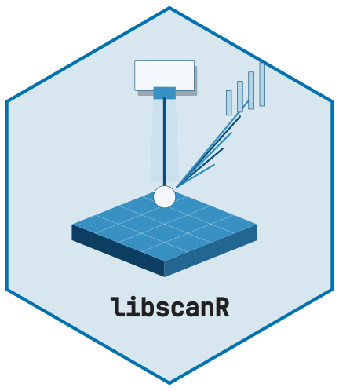
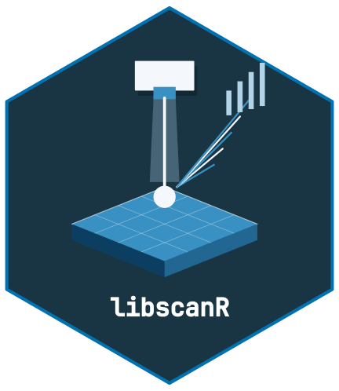

<!-- cttir-vignette-logo: start -->
<style>
.cttir-vignette-logo { float: right; width: 120px; max-width: 30%; margin: 0 0 1rem 1.5rem; }
.cttir-vignette-logo img { width: 100%; height: auto; border: 0; background: transparent; box-shadow: none; }
.cttir-vignette-logo .cttir-vignette-logo-light { display: block; }
.cttir-vignette-logo .cttir-vignette-logo-dark { display: none; }
@media (prefers-color-scheme: dark) {
  .cttir-vignette-logo .cttir-vignette-logo-light { display: none; }
  .cttir-vignette-logo .cttir-vignette-logo-dark { display: block; }
}
[data-bs-theme="light"] .cttir-vignette-logo .cttir-vignette-logo-light { display: block; }
[data-bs-theme="light"] .cttir-vignette-logo .cttir-vignette-logo-dark { display: none; }
[data-bs-theme="dark"] .cttir-vignette-logo .cttir-vignette-logo-light { display: none; }
[data-bs-theme="dark"] .cttir-vignette-logo .cttir-vignette-logo-dark { display: block; }
</style>
<div class="cttir-vignette-logo">
  
  
</div>
<!-- cttir-vignette-logo: end -->

```{r setup, include = FALSE}
knitr::opts_chunk$set(
  collapse = TRUE,
  comment = "#>",
  fig.width = 7,
  fig.height = 4.5,
  message = FALSE,
  warning = FALSE
)
```

```{r load}
library(libscanR)
```

LIBS spectra typically contain a continuum background, electronic noise,
and shot-to-shot intensity variation. `libscanR` provides chainable
preprocessing primitives: baseline correction, normalization, smoothing,
cropping, and shot averaging.

## Baseline correction

Four methods are supported: `snip`, `als`, `rolling_ball`, `linear`,
`polynomial`. SNIP and ALS are the workhorses for LIBS continuum removal.

```{r baseline, fig.alt="Three curves compare the raw fictional spectrum with SNIP and ALS baseline-corrected intensities on the same wavelength axis."}
spec <- ls_simulate_spectrum(line_data = ls_demo_peaks(),
  elements = c(Ca = 5000, Na = 1000, K = 800, Fe = 200),
  n_channels = 1024, seed = 1
)
snip <- ls_baseline(spec, method = "snip", iterations = 60)
als  <- ls_baseline(spec, method = "als", iterations = 10, lambda = 1e5)

df <- rbind(
  data.frame(w = spec$wavelength,
             y = libscanR:::.mean_intensity(spec),
             method = "raw"),
  data.frame(w = spec$wavelength,
             y = libscanR:::.mean_intensity(snip),
             method = "SNIP"),
  data.frame(w = spec$wavelength,
             y = libscanR:::.mean_intensity(als),
             method = "ALS")
)
ggplot2::ggplot(df, ggplot2::aes(w, y, colour = method)) +
  ggplot2::geom_line() + theme_libs() +
  ggplot2::labs(x = "Wavelength (nm)", y = "Intensity (a.u.)")
```

## Normalization

Five options:

```{r normalize}
norm_total <- ls_normalize(snip, method = "total")
cat("sum after total normalization:",
    round(sum(norm_total$intensity[1, ]), 2), "\n")

norm_is <- ls_normalize(snip, method = "internal_std", ref_wavelength = 589)
```

## Smoothing

```{r smooth, fig.alt="The 380 to 410 nm region of the fictional spectrum after SNIP baseline correction and seven-channel moving-average smoothing."}
sm <- ls_smooth(snip, method = "moving_avg", window = 7)
ls_plot_region(sm, 380, 410)
```

## Averaging replicate shots with outlier removal

```{r avg}
multi <- ls_simulate_spectrum(line_data = ls_demo_peaks(), seed = 1, n_channels = 512, n_shots = 20,
                              noise_level = 0.05)
avg <- ls_average_shots(multi, remove_outliers = TRUE)
avg$n_shots
```

## Cropping

```{r crop, fig.alt="SNIP-corrected fictional spectrum cropped to 380 through 450 nm, showing the simulated peak near the Ca-labelled teaching window."}
ca_region <- ls_crop(snip, 380, 450)
ls_plot_spectrum(ca_region)
```

## Recommended pipeline

```{r pipeline, fig.alt="Fictional spectrum after the recommended SNIP, five-channel moving-average and total-normalization pipeline, plotted against wavelength."}
processed <- spec |>
  ls_baseline(method = "snip", iterations = 60) |>
  ls_smooth(method = "moving_avg", window = 5) |>
  ls_normalize(method = "total")
ls_plot_spectrum(processed)
```
